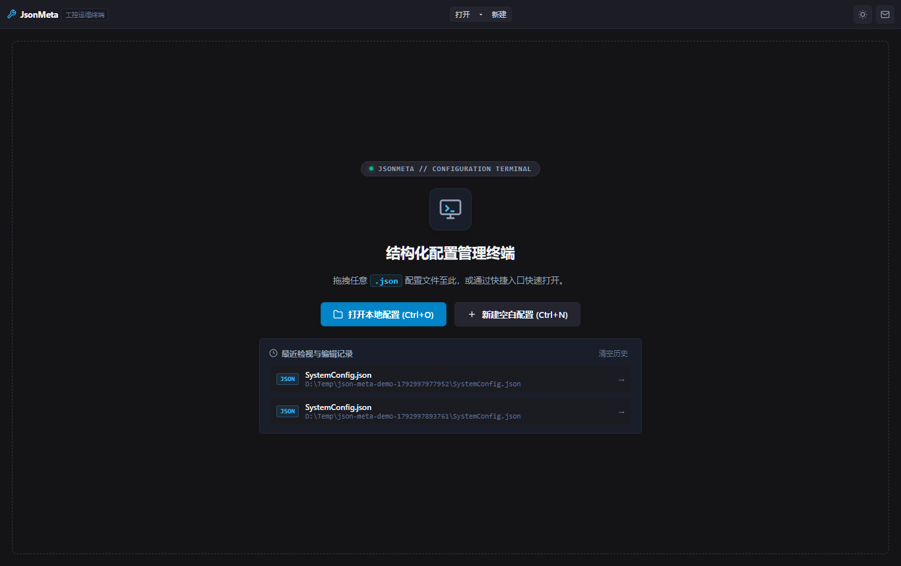
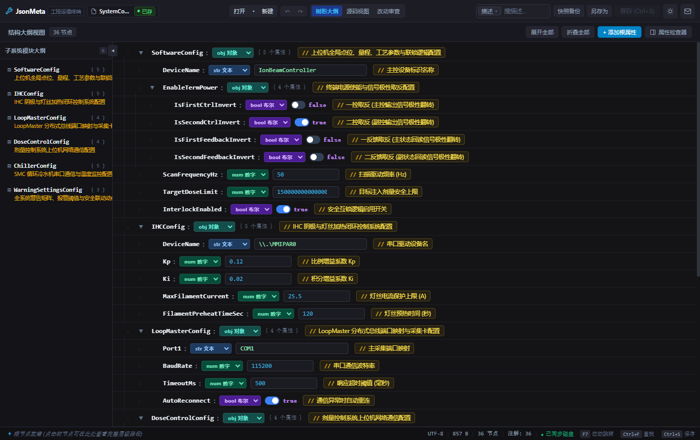
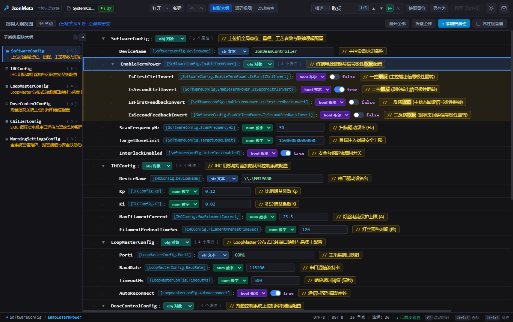
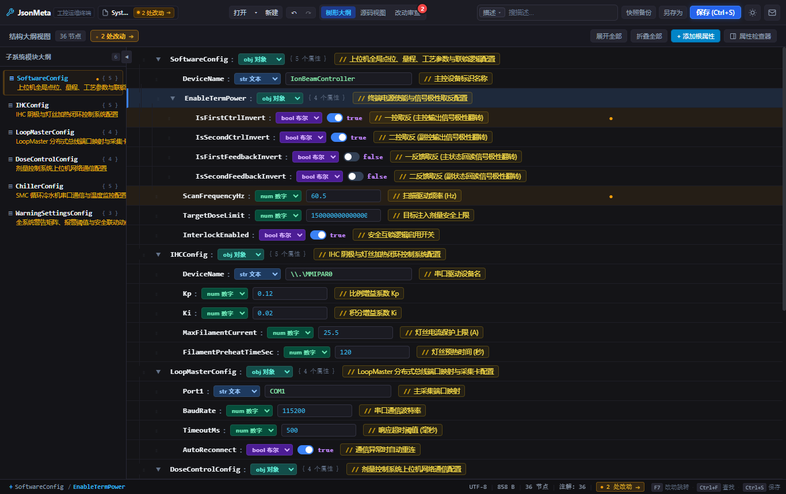
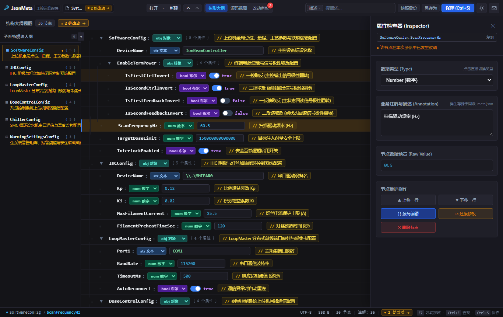
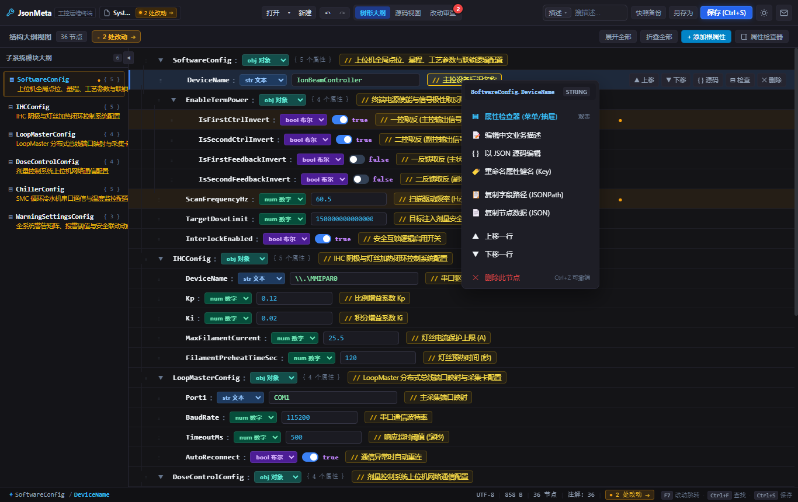
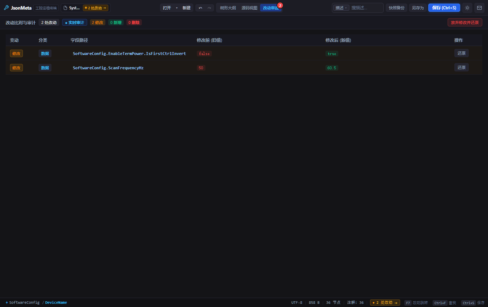
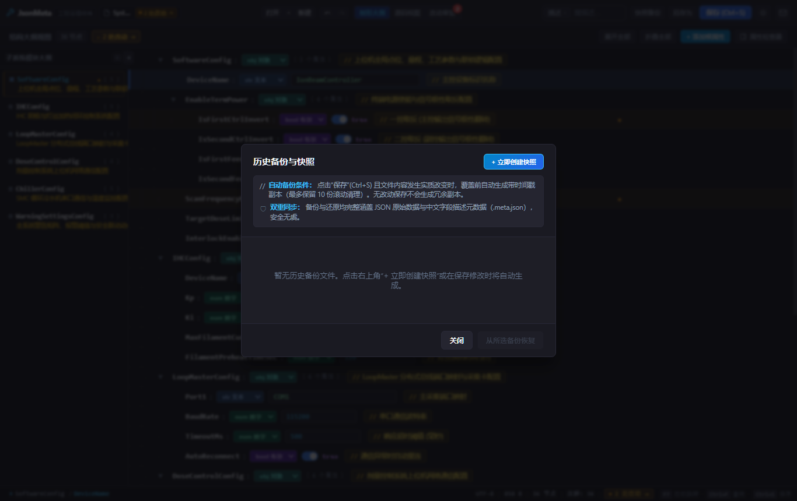
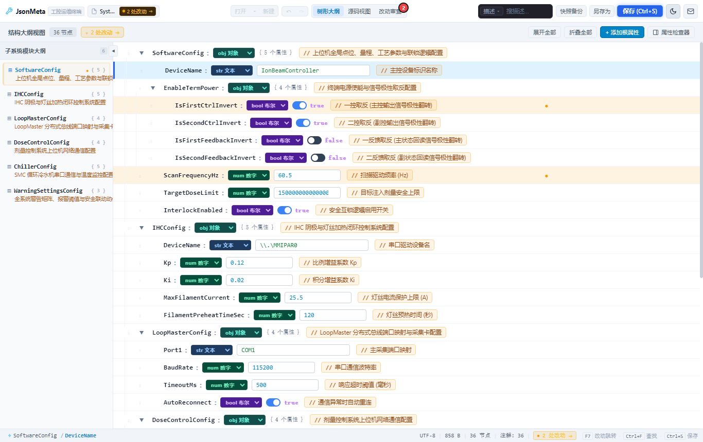
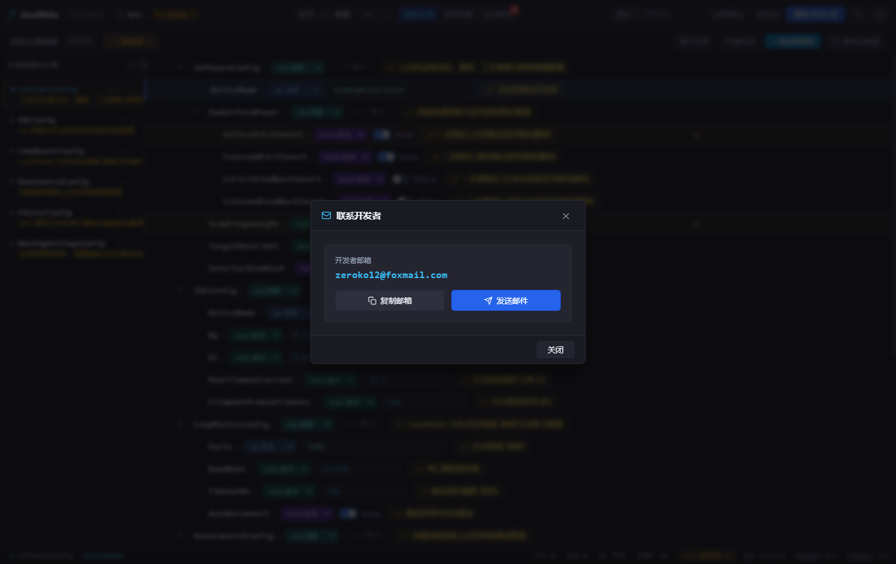

# JsonMeta 工业级配置管理与双轨注释工具

## 现场运维与工程调试实操手册

> **工具版本**：v0.1.0 (Release)  
> **适用对象**：现场运维工程师、系统集成调试人员、工控与上位机工程师  
> **技术支持邮箱**：zeroko12@foxmail.com

---

## 目录

1. [工具定位与核心架构](#1-工具定位与核心架构)
2. [快速启动与环境准备](#2-快速启动与环境准备)
3. [界面布局与工控视觉规范](#3-界面布局与工控视觉规范)
4. [配置检视与快速检索定位](#4-配置检视与快速检索定位)
5. [数据编辑与双轨注释维护](#5-数据编辑与双轨注释维护)
6. [快捷操作与节点顺序调整](#6-快捷操作与节点顺序调整)
7. [防呆审查与改动审计 (关键)](#7-防呆审查与改动审计-关键)
8. [历史镜像快照与安全回滚](#8-历史镜像快照与安全回滚)
9. [深浅双色主题与现场适应](#9-深浅双色主题与现场适应)
10. [技术支持与问题反馈](#10-技术支持与问题反馈)
11. [附录：全局工控快捷键速查表](#11-附录全局工控快捷键速查表)

---

## 1. 工具定位与核心架构

在工业现场（如半导体设备、离子注入机、自动化控制系统）中，配置文件通常是严格的机器级 JSON 格式，**原生语法完全不支持中文注释**。直接在 JSON 中编写注释会破坏控制软件的数据反序列化解析，导致软件崩溃；而缺乏注释又使现场运维人员在面对上万个点位时极易误改参数，产生严重设备安全事故。

**JsonMeta** 采用独创的**双轨伴生架构**解决上述行业痛点：

- **零污染原始数据**：主配置文件（如 `SystemConfig.json`）始终保持纯净标准格式，控制上位机读写完全不受影响；
- **双轨伴生注释文件**：所有中文字段说明、测量范围、安全联锁逻辑等元数据，自动隔离存储于同目录伴生文件 `*.meta.json` 中；
- **万级点位极速渲染**：内置虚拟滚动引擎，视口仅渲染可见行，即使面对上万个点位依然秒开、零卡顿；
- **防呆改动审计**：每次修改均记录修改前旧值与修改后新值，提供直观对比视图与撤销回滚保护；
- **自动滚动历史快照**：每次覆盖保存前自动保留带时间戳历史备份副本（最多 10 份），支持一键还原。

---

## 2. 快速启动与环境准备

### 2.1 运行模式与成品获取

本工具支持两种运行方式：

1. **免安装绿色便携版（推荐现场使用）**：
   - 文件路径：`release/JsonMeta-0.1.0-portable.exe`
   - 特点：单文件免安装，支持放在调试 U 盘中即插即用，无任何外部运行库依赖。
2. **标准安装版**：
   - 文件路径：`release/JsonMeta-0.1.0-x64.exe`
   - 特点：提供向导式安装，自动创建桌面与开始菜单快捷方式。

### 2.2 启动与空状态交互

双击启动软件后，呈现现代化工业工控终端界面：

- **拖拽打开**：直接将工程现场中的任意 `.json` 配置文件拖拽至虚线框区域即可秒级载入；
- **快捷打开**：点击中央「打开本地配置 (Ctrl+O)」按钮或按快捷键选择文件；
- **历史最近记录**：启动卡片下方自动列出最近打开过的工程文件，支持一键载入。

---

## 3. 界面布局与工控视觉规范

打开配置文件后，界面呈现工业三栏式严谨排版：

### 3.1 核心区域划分

| 区域           | 名称               | 核心功能与运维价值                                                                                                                |
| :------------- | :----------------- | :-------------------------------------------------------------------------------------------------------------------------------- |
| **顶部工具栏** | 现代化工业顶栏     | 显示当前文件名、已同步/未保存状态、新建/打开快捷按钮、视图模式切换标签、5合1 搜索胶囊、快照备份与保存按钮、深浅主题切换、技术支持 |
| **左侧侧边栏** | 子系统模块大纲     | 自动解析提取一级模块（如 SoftwareConfig、ChillerConfig、LoopMasterConfig 等），标注节点数量与中文释义，点击直达相应段落           |
| **中央工作区** | 虚拟滚动树形大纲   | 以层级缩进表格形式展示万级点位，包含拖拽把手、展开折叠箭头、字段键名、类型徽标、行内数值控件、高亮金色中文业务注释                |
| **底部状态栏** | 现场运行状态指示器 | 呈现完整层次路径面包屑、编码格式 (UTF-8)、文件体积、节点与注释统计、磁盘同步状态及快捷键引导                                      |

---

## 4. 配置检视与快速检索定位

在复杂控制系统中，定位指定点位极其耗时。JsonMeta 顶栏集成了 **5合1 智能搜索胶囊**：

### 4.1 检索特性

1. **支持拼音与首字母搜索**：
   - 输入中文（如 `取反`）、全拼（如 `qufan`）或拼音首字母，均可毫秒级命中并智能高亮。
2. **搜索范围灵活切换**：
   - 点击输入框左侧的微徽标下拉菜单，可限定搜索范围为：
     - `// 中文注释`（默认，快速通过业务语义找点位）
     - `⊞ 全部字段`（键名、描述、设定值全覆盖）
     - `# 仅键名路径`（精确查找技术英文路径）
     - `= 仅配置值`（查找具体某项设定值或端口号）
3. **定位与导航**：
   - 输入关键词后，列表自动高亮匹配文字，顶栏显示当前命中序号（如 `1/5`）；
   - 按键盘 <kbd>Enter</kbd> 或点击上/下箭头可顺次跳转到下一个目标节点。

---

## 5. 数据编辑与双轨注释维护

### 5.1 行内快速编辑

对于常见的基础参数，无需进入复杂弹窗，直接在中央列表中即可行内微调：

- **布尔开关**：点击滑块直接切换 `true` / `false`；
- **数值输入框**：支持直接输入整数、浮点数或科学计数法数值；
- **文本输入框**：支持直接编辑设备号、端口号与 IP 地址；
- **改动状态提示**：发生修改的节点右侧立即亮起橙色小圆点，顶栏与状态栏同步显示 `● N 处改动 ➔`，保存按钮高亮激活。

### 5.2 属性检查器抽屉 (Inspector)

双击某行配置项，或点击右侧「属性检查器」按钮，即可展开右侧属性抽屉：

- **完整路径复制**：顶部一键复制标准 JSONPath（如 `SoftwareConfig.ScanFrequencyHz`）；
- **类型安全切换**：可在 `String`、`Number`、`Boolean`、`Object`、`Array` 之间自由切换；
- **中文字段注释维护**：在此输入该参数在工控工艺中的含义、量程、操作规范，内容会自动保存到伴生 `.meta.json` 中；
- **微调与还原**：提供「上移一行」、「下移一行」、「源码编辑」与「一键还原单项修改」功能。

---

## 6. 快捷操作与节点顺序调整

### 6.1 节点拖拽排序 (Drag & Drop)

- 按住每一行左侧的拖拽把手图标（`⋮⋮`），直接向上或向下拖拽；
- 释放后即时调整节点在 JSON 对象或数组中的排列顺序；
- 排序变动被自动纳入改动审计跟踪，保存时严格按此顺序写入磁盘。

### 6.2 右键上下文菜单

在任意节点行上点击鼠标右键，唤出工控快捷操作菜单：

- **属性检查器 (菜单/抽屉)**：双击或点击唤起属性检查侧边栏；
- **编辑中文业务描述**：聚焦修改伴生注释；
- **以 JSON 源码编辑**：快速打开子节点 Raw JSON 弹窗进行多行编辑；
- **重命名属性键名 (Key)**：安全重命名键名；
- **复制字段路径 (JSONPath)**：快速复制至工控调试剪贴板；
- **复制节点数据 (JSON)**：快速导出该支路配置对象；
- **上移一行 / 下移一行**：键盘微调节点排列位置；
- **删除此节点**：一键安全删除（误删可随时按 <kbd>Ctrl+Z</kbd> 撤销）。

---

## 7. 防呆审查与改动审计 (关键)

在设备现场修改参数最忌讳**“盲改盲存”**。JsonMeta 提供了工业级**改动审查审计视图**：

### 7.1 审查机制

1. **统一改动监控**：在顶栏点击「改动审查」标签（带有改动数字徽标），即可切换至差异审计列表；
2. **直观新旧对比**：
   - **修改前 (旧值)**：红色底色呈现磁盘原有数值；
   - **修改后 (新值)**：绿色底色呈现本次调整数值；
3. **精准单项撤销**：若发现某项参数修改有误，点击右侧「还原」按钮，即可仅撤销该特定参数，其余正常修改不受影响；
4. **一键全部放弃**：点击右上角红框「放弃修改并还原」，瞬间重置回初始磁盘状态；
5. **快捷键导航**：在任何视图下按键盘 <kbd>F7</kbd>，光标会自动在各个改动节点之间循环跳转定位。

---

## 8. 历史镜像快照与安全回滚

现场调试过程中，设备工艺参数可能需要反复测试与回退。

### 8.1 备份规则

- **自动快照**：当按下 <kbd>Ctrl+S</kbd> 保存且文件内容确实发生改变时，系统在覆盖磁盘前自动生成带年月日时间戳的副本（最多滚动保留 10 份历史版本，防止磁盘爆满）；
- **手动快照**：点击顶栏「快照备份」打开弹窗，点击右上角「+ 立即创建快照」，可随时给当前状态打上静态备份标签；
- **双轨同步还原**：选择任意历史快照点击「从所选备份恢复」，将同步完整还原 JSON 原始数据和中文字段注释元数据，杜绝版本不同步。

---

## 9. 深浅双色主题与现场适应

车间现场环境复杂，既有昏暗机房，也有阳光直射的高亮环境。点击顶栏右上角的月亮/太阳图标即可秒级切换：

- **深色暗黑主题（默认）**：高科技工控沉浸感，保护工程师视力，适合控制室长时间作业；
- **浅色明亮主题**：黑白高对比度，强光下字迹清晰，适合车间户外强光环境。

---

## 10. 技术支持与问题反馈

点击顶栏右上角信封图标（`✉`），唤起开发者技术支持弹窗：

- **技术支持邮箱**：`zeroko12@foxmail.com`
- **一键复制**：点击「复制邮箱」按钮即可直接将邮箱地址存入剪贴板；
- **快速发件**：点击「发送邮件」将直接调用本机邮件客户端。

---

## 11. 附录：全局工控快捷键速查表

| 快捷键                                                                         | 功能操作          | 说明                                           |
| :----------------------------------------------------------------------------- | :---------------- | :--------------------------------------------- |
| <kbd>Ctrl</kbd> + <kbd>O</kbd>                                                 | 打开配置文件      | 快速弹出文件选择器载入 JSON                    |
| <kbd>Ctrl</kbd> + <kbd>S</kbd>                                                 | 保存配置文件      | 实质修改前自动触发快照，双轨文件同步落盘       |
| <kbd>Ctrl</kbd> + <kbd>Z</kbd>                                                 | 撤销上次操作      | 支持值修改、节点增删、拖拽排序等全量动作撤销   |
| <kbd>Ctrl</kbd> + <kbd>Y</kbd> / <kbd>Ctrl</kbd>+<kbd>Shift</kbd>+<kbd>Z</kbd> | 重做操作          | 恢复撤销的动作                                 |
| <kbd>Ctrl</kbd> + <kbd>F</kbd>                                                 | 聚焦全局检索      | 自动激活顶栏 5合1 搜索胶囊并选中文本           |
| <kbd>F7</kbd>                                                                  | 改动项循环定位    | 在树形大纲中依次滚动并高亮下一个未保存改动节点 |
| <kbd>Enter</kbd> (搜索框中)                                                    | 查找下一个匹配项  | 在多项搜索命中之间循环跳转                     |
| <kbd>Esc</kbd>                                                                 | 关闭弹窗/清除搜索 | 退出搜索筛选、关闭抽屉或退出模态对话框         |
| <kbd>双击节点行</kbd>                                                          | 展开属性检查器    | 快速查看该节点类型、校验规则及中文字段注释     |
| <kbd>右键节点行</kbd>                                                          | 弹出工控快捷菜单  | 唤起增删查改、复制路径及 Raw JSON 编辑菜单     |

---

_版权所有 © 2025-2026 JsonMeta Team. 保留所有权利。_
